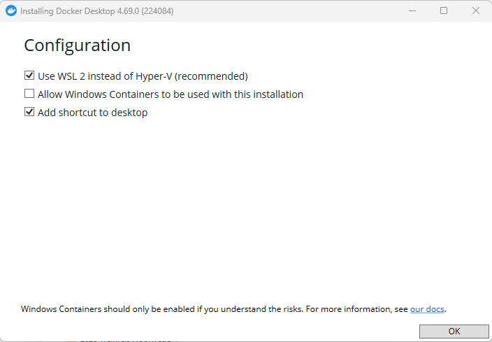
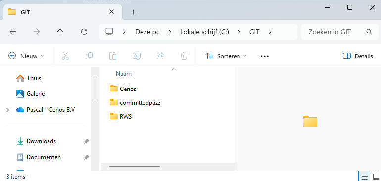
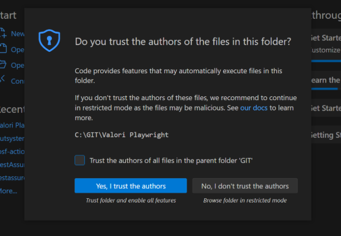
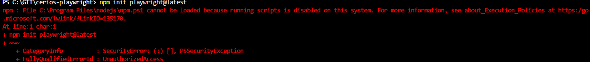
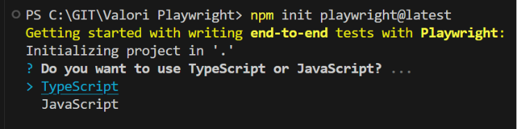
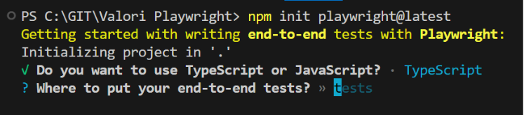
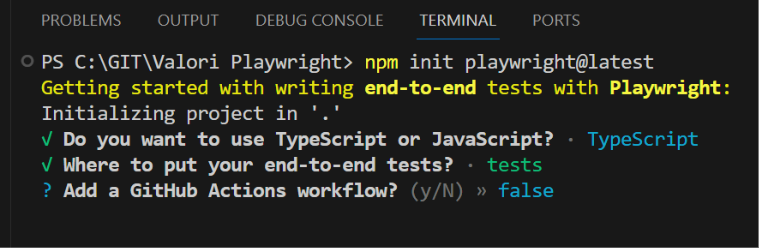
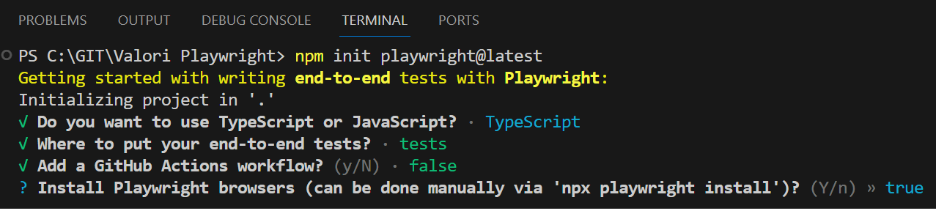
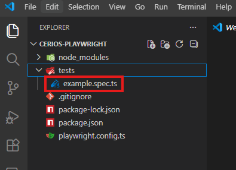

# Playwright training — Install

---

## Inhoud

1. [Basisinstallatie voor Playwright](#1-basisinstallatie-voor-playwright)
2. [Installatie Docker](#2-installatie-docker)
3. [Installatie Playwright](#3-installatie-playwright)

---

## 1 Basisinstallatie voor Playwright

De volgende spullen moeten geïnstalleerd worden voordat Playwright geïnstalleerd kan worden.

- [NodeJs](https://nodejs.org/)
- [Visual Studio Code](https://code.visualstudio.com/)
- [Git](https://git-scm.com/)

Hieronder volgt de uitleg voor de installatie van Docker en Playwright zelf.

---

## 2 Installatie Docker

Docker is nodig om lokaal de Cerios-Clinic test applicatie op te spinnen. Dit is de applicatie die we
gebruiken om onze Playwright testen tegenaan te draaien. **We gaan Docker niet gebruiken om
Playwright te installeren.**

Volg de volgende stappen:

- Download Docker Desktop via deze link: <https://www.docker.com/products/docker-desktop/>
- Doorloop de installatiewizard (waarschijnlijk slechts 1 scherm voor de configuratie)
- Zorg er voor dat **'Use WSL 2 instead of Hyper-V (recommended)'** aanstaat

  

- Na installatie herstart je je computer.
- Open Docker Desktop en wacht tot er staat **"Docker Desktop is running"**.
- Windows Home users: Docker Desktop vereist WSL 2. De installer vraagt om akkoord om dit te
  activeren.
- Open een terminal (CMD of Powershell) en type `docker --version` en controleer dat er een versie
  terugkomt.

  ```
  docker --version
  Docker version 29.0.1, build eedd969
  ```

- Type nu `docker compose version` en controleer wederom of er een versie terugkomt

  ```
  docker compose version
  Docker Compose version v2.40.3
  ```

- Als er versions worden teruggeven in de terminal ben je klaar met de installatie van Docker.

---

## 3 Installatie Playwright

Dan gaan we nu beginnen met opzetten van een Playwright project.

- Maak via een explorer (CTRL+E) een nieuwe map aan op jouw `C:` schijf genaamd **GIT**

  


- Maak in deze GIT folder weer een map aan genaamd **cerios-playwright**
- Open VS-code
- Klik in het menu op **File -> Open Folder …** -> open de zojuist aangemaakte folder
- Natuurlijk vertrouw je jouw eigen spullen ("Yes, I trust the authors")

  

- Klik in het menu op **Terminal -> New Terminal** en er verschijnt een terminal onderin
- Voer hier het volgende commando uit:

  ```
  npm init playwright@latest
  ```

Het kan zijn dat je tegen het volgende aanloopt:



In dat geval helpt het volgende commando:

```
Set-ExecutionPolicy -ExecutionPolicy RemoteSigned -Scope CurrentUser
```

Beantwoord vervolgens de setup-vragen als volgt:

- **Do you want to use TypeScript or JavaScript?** → TypeScript (enter)

  

- **Where do you want to put your tests?** → DEFAULT `tests` (enter)

  

- **Add a GitHub Actions workflow?** → false (n)

  

- **Install Playwright browsers (can be done manually via 'npx playwright install')?** → DEFAULT true
  (enter)

  

Nu worden alle browsers lokaal geïnstalleerd in jouw APPDATA. Dit is gelijk een mooi punt t.o.v. andere
libraries zoals Selenium. Playwright maakt gebruik van zijn eigen browsers. Nooit meer driver updates om
met jouw lokale browser te kunnen babbelen. Daarnaast zie je ook dat in de explorer aan de linkerzijde
een aantal folders en files zijn aangemaakt (`node_modules`, `tests`, `.gitignore`, `package-lock.json`,
`package.json`, `playwright.config.ts`).

- Verwijder de file `tests/example.spec.ts`, want wij gaan natuurlijk zelf onze testen maken.

  

Nu ben je ready steady voor de Playwright training. Tot snel!
